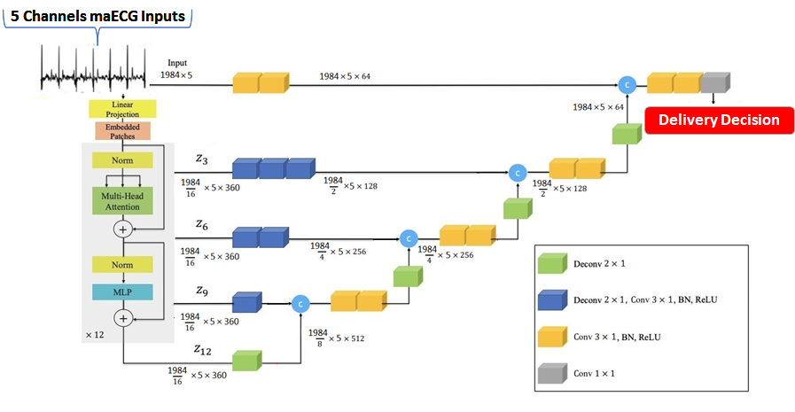
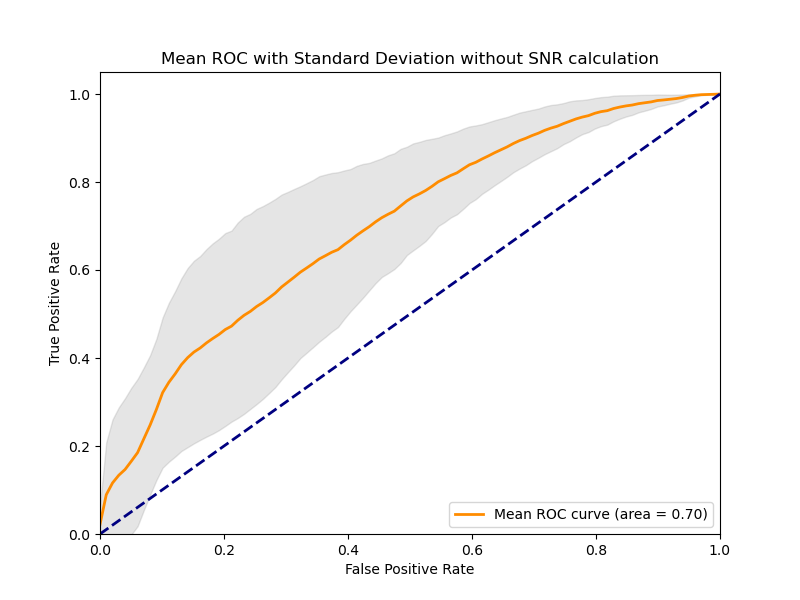
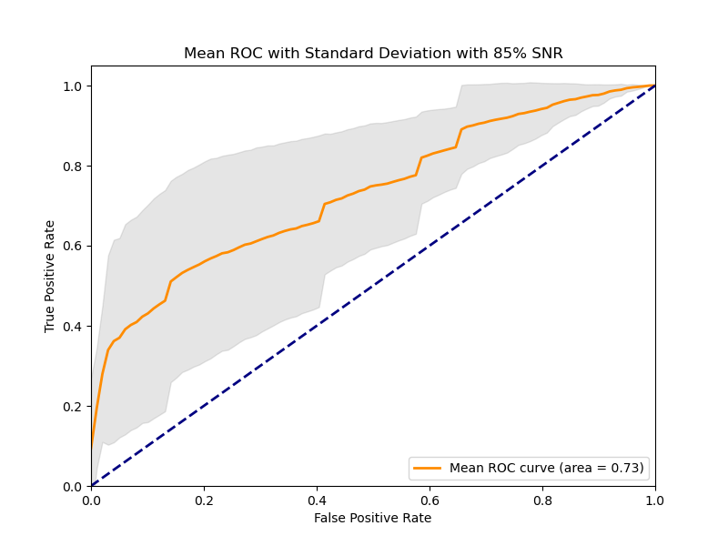
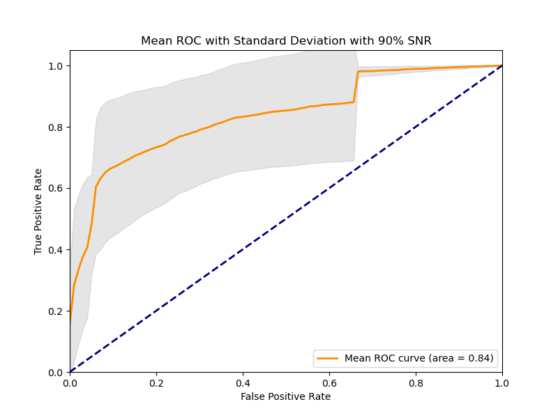
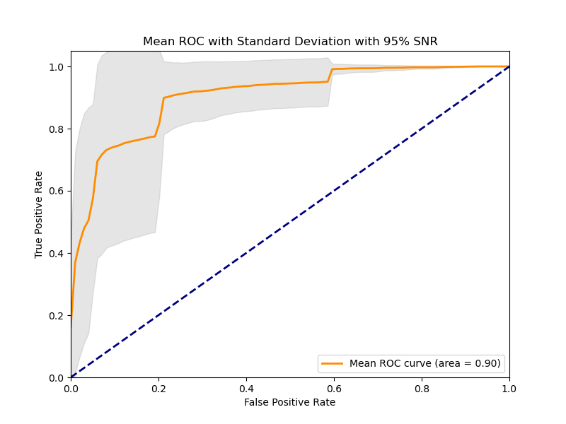

# One-Dimensional UNETR for Maternal Abdominal ECG Delivery-Time Prediction

This repository contains research code associated with the manuscript:

> **Prediction of Imminent Spontaneous Late-Gestation Delivery From Maternal Abdominal ECG Using a Transformer Model: A Feasibility Study**  
> Murad Almadani, Emerson Keenan, Leontios Hadjileontiadis, Marimuthu Palaniswami, and Ahsan Khandoker.  
> Manuscript prepared for submission to the *IEEE Journal of Biomedical and Health Informatics (JBHI)*.

The study investigates whether maternal abdominal ECG can distinguish **delivery less than 7 days after recording** from **delivery 7 days or longer after recording**. It is a feasibility study, not a validated clinical prediction system.



## Framework

The model is a one-dimensional adaptation of a transformer encoder and U-Net-like decoder (UNETR), implemented using PyTorch and MONAI. See the [MONAI project](https://github.com/Project-MONAI/MONAI) and the [UNETR architecture paper](https://arxiv.org/abs/2103.10504).

The primary analysis used **five-channel maternal abdominal ECG**, **participant-wise five-fold cross-validation**, and participant-level evaluation. All windows from a participant belong to the same fold.

## Manuscript experiment settings

The following values are **reported in the JBHI manuscript** for the primary abdominal ECG experiment. They are not necessarily the defaults currently defined in `init.py`; verify the actual command-line arguments, training logs, and code before treating this table as an executable reproduction configuration.

| Setting | Primary abdominal ECG experiment |
| --- | --- |
| Recording duration | 30 minutes per participant |
| Original ECG sampling rate | 1,000 Hz |
| Resampled ECG rate | 333 Hz |
| Analysis-window duration | Approximately 6 seconds |
| Model input shape | `1984 × 5` (samples × channels) |
| Temporal patch length | `16` samples |
| Flattened patch dimension | `16 × 5 = 80` values |
| Number of temporal patches | `1984 / 16 = 124` |
| Transformer embedding dimension | `360` |
| Transformer depth | `12` layers |
| Attention heads | `12` |
| Optimizer | AdamW |
| Initial learning rate | `5e-5` |
| Batch size | `90` |
| Training epochs | `10` |
| Loss | Binary cross-entropy |
| Evaluation | Participant-wise, stratified five-fold cross-validation |

**Configuration warning:** The repository defaults described in the coauthor review differ from the manuscript values (`3968`, `40`, and `0.01` versus the input length, batch size, and learning rate above). These differences must be traced to the actual historical run configuration, command-line overrides, or distinct experiments before claiming exact reproducibility. In particular, a variable named `patch_size` in the code may describe a full input crop rather than the transformer's *16-sample temporal patch length*; inspect its usage instead of assuming these terms are interchangeable.

The paper also includes exploratory alternative prediction horizons, signal-quality filtering thresholds, lead configurations, input-window durations, and a separate EHG experiment. Their settings should not be assumed to match the primary abdominal ECG configuration.

## Repository files and roles

The original workflow references the following files. Check the repository tree and update these paths if files have been renamed or moved.

| Path | Purpose |
| --- | --- |
| `train.py` | Training and testing workflow |
| `init.py` | Configuration and runtime options |
| `networks.py` | One-dimensional UNETR implementation |
| `Dataset/generate_dataset.py` | Organizes signals and labels into the expected data structure |
| `Dataset/Dataset_gen2.py` | Creates or selects training/validation partitions |
| `ROC.py` | Generates ROC summaries from fold outputs, where available |
| `images/` | Architecture and result figures used in this README |

The original instructions also refer to `Dataset/Dataset_gen.py` and `installation_commands.txt`. Their availability and exact roles have **not been verified**. Do not assume those files exist solely because they were mentioned in earlier documentation.

## Installation

Use an isolated Python environment compatible with the versions required by the checked-in code. The original project was developed using MONAI 0.7.0; dependency compatibility should be verified against the actual source and environment.

```bash
conda create -n delivery-unetr python=3.8
conda activate delivery-unetr
```

Install PyTorch with a CUDA or CPU build appropriate for your machine, then the MONAI release and any additional imports required by this repository. **The precise historical package versions and a tested installation command have not yet been established from the supplied README.** Do not treat the environment above as an independently validated reproduction environment.

Consult `train.py`, `init.py`, and the import statements to determine the required dependencies. If an environment file or installation script is added to the repository, use it as the authoritative source.

## Data and participant-level splitting

The clinical abdominal ECG dataset is not publicly distributed through this repository. Access is subject to consent, ethics, and institutional approval. Therefore, full reproduction of the reported numerical results requires authorized access to the underlying participant recordings and labels.

In the manuscript, the primary 7-day analysis comprised **74 participants**, with **17** delivering less than 7 days after recording and **57** delivering 7 days or longer after recording. Participant-level fold composition was:

| Fold | Delivery <7 days | Delivery ≥7 days | Total |
| --- | ---: | ---: | ---: |
| 1 | 3 | 11 | 14 |
| 2 | 3 | 11 | 14 |
| 3 | 3 | 11 | 14 |
| 4 | 4 | 12 | 16 |
| 5 | 4 | 12 | 16 |
| **Total** | **17** | **57** | **74** |

**Prevent leakage:** Each participant's analysis windows must be assigned to only one fold. Training and evaluation must not share windows from the same participant. The original workflow uses manual fold selection in the dataset splitting script; verify and record the selected fold before each run. Avoid relying on hard-coded source line numbers, which change as code evolves.

## Training workflow

The original repository workflow is:

1. Prepare authorized participant signals and outcome labels using `Dataset/generate_dataset.py`, checking the actual input and output paths in that script.
2. Select a **participant-wise** fold using `Dataset/Dataset_gen2.py` or the actual fold-selection script in the current tree.
3. Set dataset paths and runtime options in `train.py` / `init.py` or using supported command-line overrides.
4. Verify that the effective options match the intended experiment. For the **primary ECG experiment**, the manuscript reports input `1984 × 5`, learning rate `5e-5`, batch size `90`, and `10` epochs.
5. Execute `train.py` according to its current command-line interface. Record the command, fold assignment, random seed, environment, epoch checkpoints, and effective configuration.
6. Repeat for each of the five held-out participant folds, always starting a new model from scratch and keeping participant windows separated.

### Checkpoint selection — verification required

An earlier version of this README instructed users to **select the epoch with the lowest validation loss**. That historical instruction is not sufficient to establish how the reported manuscript models were actually selected. If the same held-out participants were used both to select the checkpoint and to estimate final test performance, the held-out evaluation was also involved in model selection, and the manuscript's independence claim requires correction or the experiment requires re-evaluation with a separate checkpoint-selection set.

**Do not assume** that the last epoch, lowest-training-loss epoch, or lowest-validation-loss epoch was used for the paper without checking the historical training logs and saved models. The authoritative checkpoint policy should be documented after it has been verified from those artifacts. For a future fully independent evaluation, checkpoint selection should use training-only data or a nested validation split, while the final held-out fold remains untouched until evaluation.

## Evaluation

For the manuscript's abdominal ECG evaluation:

- **ROC-AUC:** Average the available window-level predicted probabilities to one continuous score per held-out participant; compute participant-level ROC-AUC within each fold. Reported ROC-AUC values are the **mean of five fold-specific participant-level AUCs**, not one pooled window-level or pooled out-of-fold AUC.
- **Confusion matrices:** Convert window probabilities to binary labels at threshold `0.5`, then use a majority vote across the participant's windows. This is distinct from thresholding the mean participant-level probability.
- **Quality-filtered analyses:** Use only windows meeting the specified spectral quality threshold for the corresponding analysis; a participant was retained under the manuscript's reported rule if at least one window passed. The evaluated set may therefore change with the threshold.

The unfiltered primary 7-day experiment reported mean participant-level ROC-AUC **0.64** in **74 participants**. The >95% spectral signal-quality subgroup reported mean ROC-AUC **0.91** in **54 participants** (10 positive and 44 negative). **These values are not a fixed-cohort estimate of the gain from filtering.**

The original repository instructions refer to testing via options in `init.py` and checkpoint loading in `train.py`. Verify the current argument names and checkpoint-loading implementation rather than modifying source lines by number.

## Figures and reported results

The original repository used `ROC.py` to summarize fold predictions. Where the image files are present, the following visuals illustrate the published experiment outputs:









We achieve the following confusion matrix for the best of the 5-fold validation process:


These existing images are illustrative repository assets. They do not replace the participant-level predictions, fold assignments, or experimental configuration required for independently regenerating the numerical results.

## Reproducibility and limitations

- The clinical dataset is access-restricted; public code alone cannot reproduce the results without approved data access.
- Historical runtime overrides and the precise checkpoint-selection procedure require verification before claiming that the repository fully reproduces the paper.
- Signal-quality filtering changes participant coverage and class composition. The high-quality subgroup ROC-AUC is not representative of unfiltered clinical performance.
- Lead, window-duration, prediction-horizon, and external EHG analyses are exploratory and were not all evaluated on identical cohorts.
- The current study does not establish superiority over clinical or simpler machine-learning baselines and requires independent validation.

## Citation

If you use this repository, please cite the manuscript after bibliographic publication details become available:

> M. Almadani, E. Keenan, L. Hadjileontiadis, M. Palaniswami, and A. Khandoker, “Prediction of Imminent Spontaneous Late-Gestation Delivery From Maternal Abdominal ECG Using a Transformer Model: A Feasibility Study,” manuscript prepared for submission to *IEEE Journal of Biomedical and Health Informatics*.

## Research-use notice

This software is research code and is **not intended for clinical diagnosis, labour management, or independent medical decision-making**.
