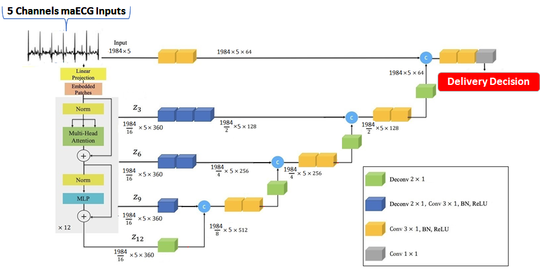
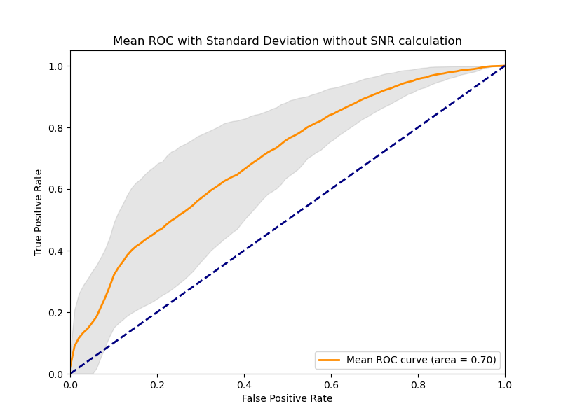
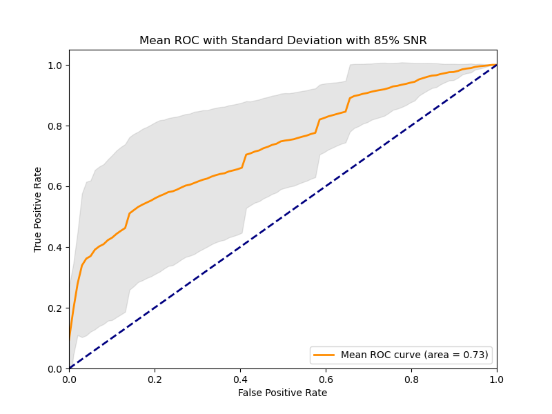
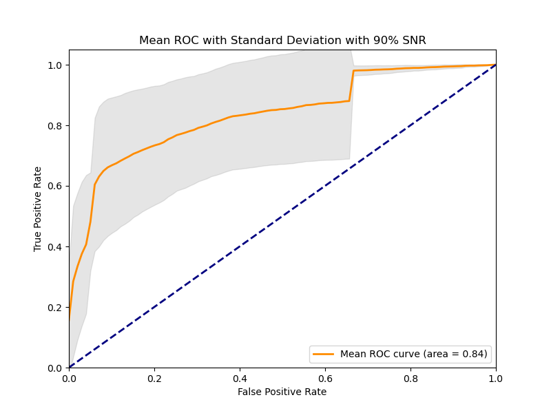
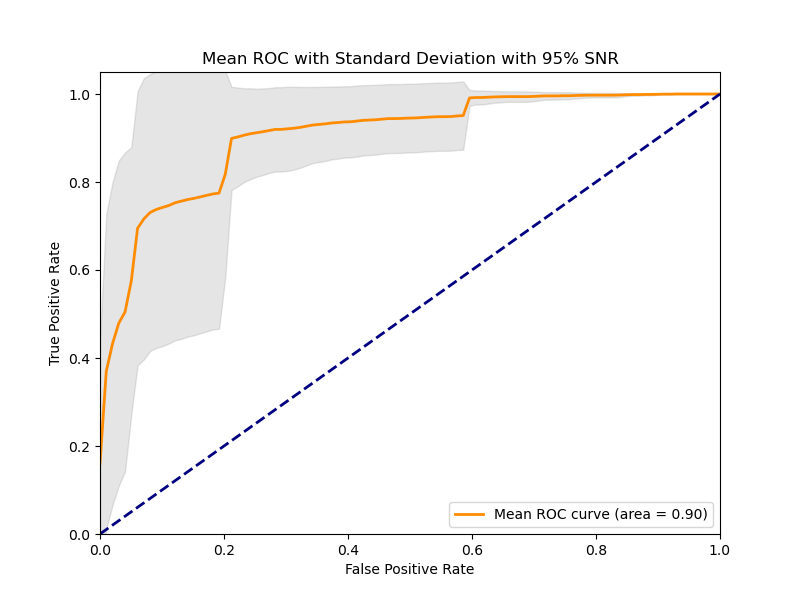

- One-dimensional UNetR is based on MONAI 0.7.0 : PyTorch-based, open-source frameworks for deep learning in healthcare signals. 
(https://github.com/Project-MONAI/MONAI)
https://arxiv.org/abs/2103.10504

*******************************************************************************
## Requirements
Follow the steps in "installation_commands.txt". Installation via Anaconda and creation of a virtual env to download the python libraries and pytorch/cuda.
*******************************************************************************
## Python scripts and their function

- train.py: The main training code
- init.py: List of options used to train the network. 
- networks.py: The one-diminsional UNetR architecture for pregnancy time of delivery prediction.
- Dataset/generate_dataset.py: Organize the data in the folder structure (class_num,signal) for the network.
- Dataset/Dataset_gen2.py: A code to split the training and validation sets.

*******************************************************************************
## Usage
### Training process:

First run the "Dataset/generate_dataset.py" code to generate data samples on "signal" and "class_num" folders.
Then run the "Dataset/Dataset_gen2.py" to generate the training-validation splitting sets.
Afterwards, change the dataset directory in "train.py" code line number 42.
Then, run the "train.py" code to generate the models at each iteration of the 10.
Finally, make sure to choose the best iteration model that the lowest validation loss value and discard others.

### Testing process:

To test the generated model for that specific validation set, just change the line number 37 in "init.py" to be equal to "True".
Then change the line number 106 in "train.py" code with the best iteration model achieved in the previous training step.
Finally run the "train.py" code again to generate the predictions and the corresponding labels in the same directory.

### 5-Fold validation-training process

Repeat the whole previous process 5 times to generate the 5-fold validation-training process by making sure to change the validation-training set in "Dataset/Dataset_gen2.py" at each time. To do so just comment/uncomment lines between 23-27 and 34-38 in "Dataset/Dataset_gen.py" at each training time.

*******************************************************************************
### Results:

To generate the ROC of the 5-fold validation process make sure to place the 5 results files in the same "ROC.py" code directory and run it. We achieve mean and standard deviation ROC as depicted in the following figure:

After incorporating the SNR quality signal index, we achieve the following three ROCs for 85%, 90%, and 95% SNRs respectively:

We achieve the following confusion matrix for the best of the 5-fold validation process:

### UNetR for pregnancy time of Delivery prediction Notes from the authors:

One-Dimensional UNetR for pregnancy time of delivery paper with more descriptions is now publicly available. Please check for more details:
Murad Almadani, Emerson Keenan, Leontios Hadjileontiadis, Marimuthu Palaniswami, and Ahsan Khandoker. "Pregnancy Time of Delivery Prediction using Transformer-based Deep Learning Method" Journal of -- (2023).

